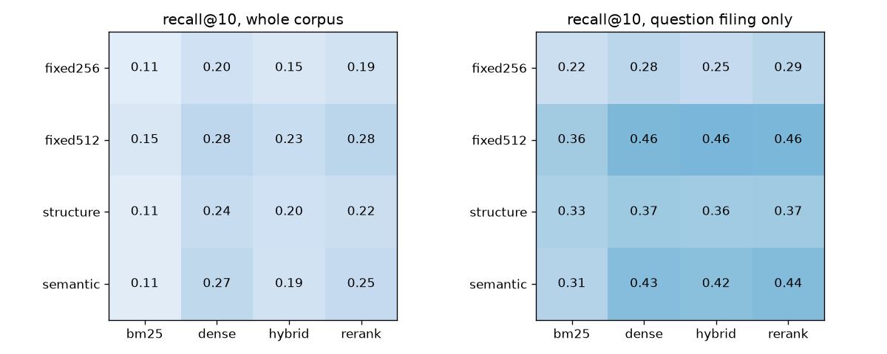

# rag-retrieval-eval

Retrieval evaluation for RAG over SEC filings. It takes the 150 open-source FinanceBench questions and the 84 filings they cite, crosses four chunkers (fixed 256 and 512 tokens, paragraphs merged up to 400 tokens and split at Item headings, embedding-distance breakpoints) with BM25, bge-small dense, RRF hybrid and cross-encoder reranking, and scores every pair on evidence recall@k, MRR@10 and nDCG@10 over the whole corpus or only the question's filing. An answer-and-judge step for faithfulness is included but has not been run.

## Running it

```
uv sync
uv run data.py       # questions from HF, the 84 cited PDFs (166 MB) from GitHub, page text -> data/pages.parquet
uv run chunk.py      # four chunkings -> data/chunks/
uv run retrieve.py   # BM25 indexes, bge-small embeddings -> data/emb/, results/index_build.csv
uv run evaluate.py   # labels, every chunker x retriever x scope -> results/
```

Needs Python 3.12 and uv; only `answer.py` needs an API key. Each step's printed output is in `results/*.log`, `results/retrieval.csv` has recall@1/5/10/20, MRR@10, nDCG@10 and p50 latency for all 32 runs, and `results/per_question.csv` has the per-question scores.

## Results

"corpus" searches all 84 filings and "filing" only the question's filing (`doc` in the CSVs and on the command line). "own filing in top 10" is the share of the whole-corpus top 10 that came from the question's filing. p50 is per query over the whole corpus, including query embedding and the cross-encoder, on an M1 laptop (MPS) that was running other jobs, so treat timings as relative.

| chunker | retriever | R@10 corpus | R@10 filing | MRR@10 corpus | MRR@10 filing | nDCG@10 corpus | nDCG@10 filing | own filing in top 10 | p50 ms |
|---|---|---|---|---|---|---|---|---|---|
| fixed256 | bm25 | 0.107 | 0.221 | 0.064 | 0.113 | 0.068 | 0.179 | 0.21 | 2 |
| fixed256 | dense | 0.201 | 0.284 | 0.112 | 0.183 | 0.139 | 0.250 | 0.36 | 21 |
| fixed256 | hybrid | 0.150 | 0.251 | 0.079 | 0.158 | 0.099 | 0.242 | 0.29 | 20 |
| fixed256 | rerank | 0.193 | 0.291 | 0.102 | 0.164 | 0.119 | 0.241 | 0.30 | 323 |
| fixed512 | bm25 | 0.150 | 0.363 | 0.100 | 0.202 | 0.099 | 0.225 | 0.23 | 1 |
| fixed512 | dense | 0.276 | 0.456 | 0.149 | 0.267 | 0.160 | 0.307 | 0.36 | 15 |
| fixed512 | hybrid | 0.232 | 0.462 | 0.123 | 0.278 | 0.136 | 0.310 | 0.31 | 17 |
| fixed512 | rerank | 0.282 | 0.458 | 0.150 | 0.268 | 0.156 | 0.291 | 0.33 | 549 |
| structure | bm25 | 0.113 | 0.331 | 0.092 | 0.169 | 0.087 | 0.225 | 0.21 | 2 |
| structure | dense | 0.237 | 0.374 | 0.131 | 0.236 | 0.151 | 0.286 | 0.34 | 15 |
| structure | hybrid | 0.200 | 0.364 | 0.113 | 0.225 | 0.126 | 0.281 | 0.29 | 17 |
| structure | rerank | 0.223 | 0.370 | 0.119 | 0.207 | 0.139 | 0.261 | 0.32 | 503 |
| semantic | bm25 | 0.110 | 0.308 | 0.062 | 0.167 | 0.065 | 0.209 | 0.20 | 2 |
| semantic | dense | 0.273 | 0.431 | 0.153 | 0.271 | 0.170 | 0.305 | 0.34 | 16 |
| semantic | hybrid | 0.193 | 0.418 | 0.083 | 0.222 | 0.105 | 0.282 | 0.27 | 18 |
| semantic | rerank | 0.250 | 0.440 | 0.134 | 0.226 | 0.156 | 0.281 | 0.31 | 478 |



| chunker | chunks | mean tokens | coverable evidence | chunking s | BM25 build s | embedding s |
|---|---|---|---|---|---|---|
| fixed256 | 37348 | 256 | 0.762 | 19 | 3.4 | 345.0 |
| fixed512 | 18688 | 511 | 0.979 | 19 | 3.3 | 365.1 |
| structure | 24692 | 339 | 0.921 | 20 | 4.5 | 543.5 |
| semantic | 32022 | 261 | 0.931 | 574 | 3.0 | 515.2 |

What stands out:
- Absolute recall is low, and filtering to the question's filing raised recall@10 in all 16 chunker and retriever pairs, by 0.083 to 0.230 (fixed512 dense goes from 0.276 to 0.456). Over the whole corpus only 0.20 to 0.36 of the top 10 comes from the right filing; the rest is similar text from other companies or other years of the same one.
- Dense beat BM25 in every cell, and equal-weight hybrid pulled whole-corpus recall below dense alone for all four chunkers. BM25 struggles with long questions full of instructions and with wording that differs from the statements ("capital expenditure" against "Purchases of property, plant and equipment").
- The cross-encoder didn't earn its latency: reranking the hybrid top 50 ended near dense alone (fixed512: 0.282 vs 0.276 over the corpus, 0.458 vs 0.456 in the filing) at 323 to 549 ms per query against 15 to 21 ms for dense. It also had lower MRR@10 than dense in the filing for three of four chunkers.
- fixed512 had the best recall@10 for every retriever in both scopes, partly by construction, since fixed256 can hold only 0.762 of the evidence passages at all. Semantic chunks beat structure-aware ones with dense retrieval (0.431 vs 0.374 in the filing) but took 574 s of paragraph embedding to build against 20 s.

## How relevance is defined

Pages are joined into one string per filing, every chunk is a character span of it, and the filing scope is a metadata filter on the same index (BM25 IDF still comes from the whole corpus). Each evidence passage is located on its cited page by difflib token alignment (`evidence_page_num` is 0-based: all 189 passages align best at that index, match median 1.00), so every chunker is graded against the same positions. Recall@k is the share of a question's passages with a grade-2 chunk in the top k, MRR@10 counts the first grade-2 chunk, and nDCG@10 uses the grades as gains:
- 2 if the chunk covers at least half of the passage
- 1 if it overlaps the evidence page but covers less
- 0 otherwise

## Faithfulness step (not run)

`answer.py` answers each question from its top 5 chunks with `claude-sonnet-5-5`, then makes two judge calls with structured output: one splits the answer into claims and marks each as supported or not by those chunks (faithfulness = supported / total), the other checks it against FinanceBench's reference answer. No API key was available, so it has not been run and there are no faithfulness numbers here. It makes three calls per question and writes `results/answers_<chunker>_<retriever>_<scope>.jsonl`; drop `--limit` to run all 150.

```
ANTHROPIC_API_KEY=... uv run answer.py --chunker structure --retriever rerank --scope doc --limit 20
```

## Limitations

- 150 questions is small, so gaps of a point or two are noise.
- PDF tables extract poorly. Statement rows come out as runs of labels and numbers far from their column headers, and the statement chunks I checked ranked low with both BM25 and the small embedding model.
- Only the cited page counts. The same figure often appears elsewhere in a filing (MD&A repeats the statements), so some misses would still answer the question.
- LLM-judge bias: one model answers and judges, judges lean lenient, and how finely an answer is split into claims moves the faithfulness ratio.
